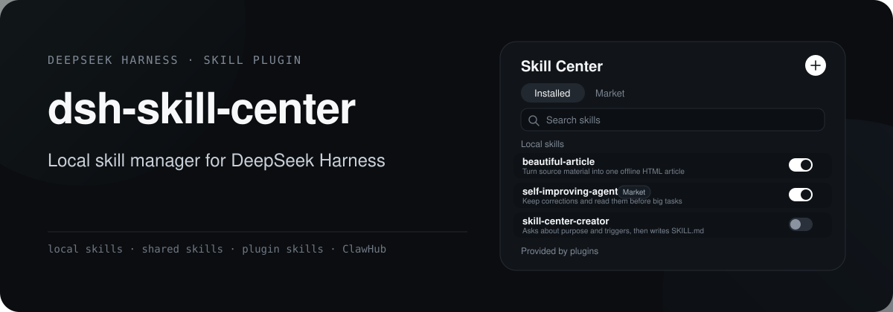
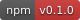
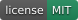
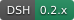
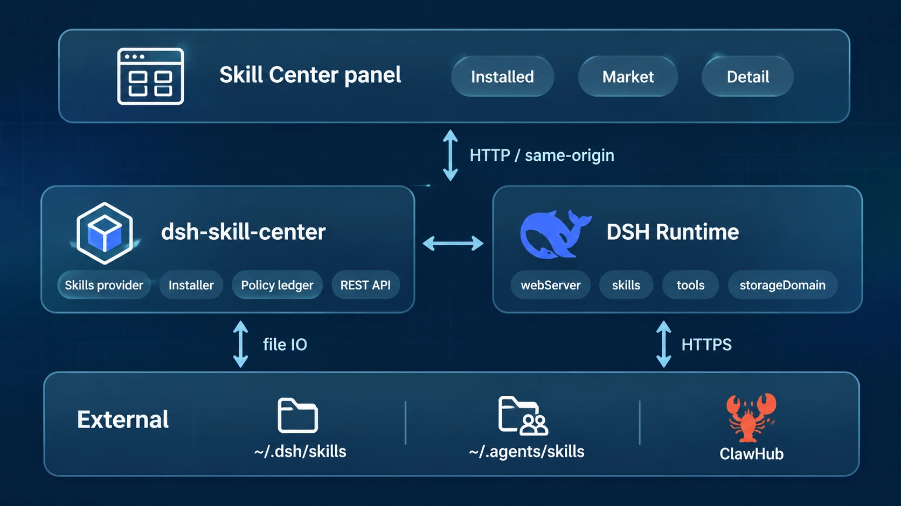
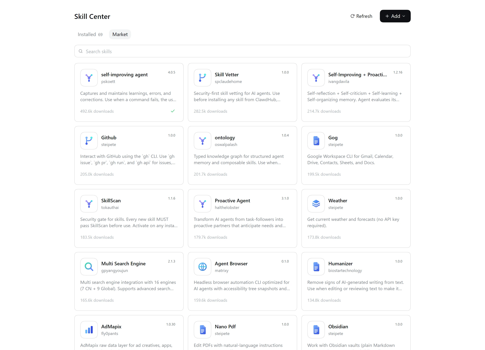

<p align="center">
  
</p>

<div align="center" class="text-center">
  <a href="./README.md">简体中文</a> · <strong>English</strong>
</div>

<br>

<div align="center" class="text-center">
  <a href="https://www.npmjs.com/package/@double-coding/dsh-skill-center"></a>
  <a href="https://github.com/double-coding-lab/dsh-skill-center"></a>
  <a href="https://github.com/double-coding-lab/dsh-skill-center/blob/main/LICENSE"></a>
  
</div>

dsh-skill-center is the skill panel for DeepSeek Harness: list local, shared and plugin-provided skills, toggle them on or off, create and import your own, and install from ClawHub.

## Architecture

<p align="center">
  
</p>

- The panel calls the plugin host under `/dsh-skill-center/api/*`. The client sends skill names and market identifiers only; the host rebuilds every path.
- Toggling never writes `SKILL.md`. The plugin publishes a lower-rank override from its own skills provider to shadow disabled names.
- Skills come from `~/.dsh/skills`, `~/.agents/skills` and agent presets. ClawHub supplies the download chart, search and version metadata.

## UI and demo



The market tab shows the ClawHub download chart with search. You can read the `SKILL.md` body before installing.

## What it does

### One list for every skill

The same skill can exist in the local directory, the shared directory and an agent preset. The panel merges copies by name and shows one row; the detail page lists every copy and its real path.

| Source | Location | Available actions |
| --- | --- | --- |
| Local skills | `~/.dsh/skills` | View, toggle, create, import, delete |
| Shared skills | `~/.agents/skills` | View, toggle, delete |
| Plugin skills | Skills providers registered by the host | Read-only |

### Toggles leave the source file alone

Toggle state lives in the plugin's local policy ledger, and `SKILL.md` is never touched. The same file may also be used by Codex, Qoder or other tools; rewriting its frontmatter would leak state into their configuration and could not be undone by uninstalling this plugin.

### Detail page

Path, every copy, the Markdown-rendered body, catalog version and local modification state. Symlinked skills show where they point and stay read-only and undeletable.

### Create a skill

Type a short goal in the panel. The plugin opens `skill-center-creator` in a new session; the creator asks about purpose, triggers and constraints, then calls `skill_center_create` to write the skill under `~/.dsh/skills`.

### Import a skill

Drop a `.zip`, a whole folder or a single `SKILL.md`. Paths, file count and unpacked size are checked before import; a name conflict asks before overwriting.

### Market

Browse the ClawHub download chart, search, preview the body, then install, update or uninstall. Skills installed from the market use "Uninstall" in the list and detail page, separate from ordinary deletion.

### Follows the DSH language

The panel, market, detail pages and dialogs follow the Chinese/English switch in DSH settings. Changes apply immediately, with no need to reopen the panel.

## Install

Requires DeepSeek Harness 0.2.x. DSH Desktop ships its own runtime; when installing through the `dsh` CLI, use the Node.js version DSH requires.

### DSH Desktop

Open "Settings → Plugins", choose "Add plugin", enter `@double-coding/dsh-skill-center` and follow the prompts.

Desktop owns its profile. Quit Desktop completely and start it again after installing.

### dsh web

```bash
dsh plugin --profile web add @double-coding/dsh-skill-center
```

Stop the running `dsh web` process and start it again. Refreshing the page alone will not load the host plugin.

<details>
<summary>Install from source</summary>

```bash
npm install
npm run build
dsh plugin --profile <profile> add link:.
```

Replace `<profile>` with the profile your host actually loads, then restart the same way.

</details>

### Open the panel

A "Skill Center" entry appears in the sidebar, with "Installed" and "Market" tabs.

## Environment

| Variable | Default | Purpose |
| --- | --- | --- |
| `DSH_HOME` | `~/.dsh` | Writable skill root `$DSH_HOME/skills` |
| `DSH_AGENTS_HOME` | `~/.agents` | Shared skill root `$DSH_AGENTS_HOME/skills`; view, toggle and delete here, but no new skills are created in it |

## Security boundaries

- Routes live on the host web server; no extra port. Mutations check same-origin.
- The server rebuilds all paths; the client only sends skill names and `owner`/`slug`.
- Archives: relative paths only, depth ≤ 8, files ≤ 500, unpacked size ≤ 64 MiB.
- Catalog content is third-party prompt text: preview before install, never auto-install, never run scripts bundled with a skill.
- If policy storage is unreadable, every skill counts as disabled and writes are refused.

## Development

```bash
npm run typecheck   # host + client
npm run build       # tsc + esbuild
npm test            # names, frontmatter, archives, policy, provider candidates
npm run check       # all of the above
```

## Third-party

`skills/skill-center-creator` is taken from [`skill-creator` in anthropics/skills](https://github.com/anthropics/skills), used under Apache-2.0; see `LICENSE.txt` in that directory. Changes are limited to the frontmatter name and a short DeepSeek Harness section about where skills are written and how the tests run.

## License

[MIT](./LICENSE)
