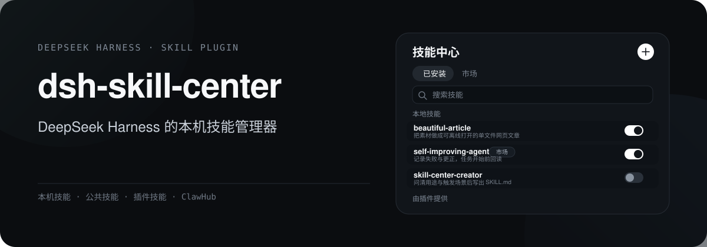
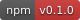
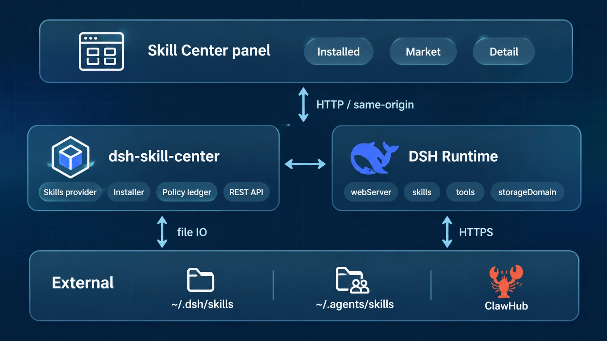
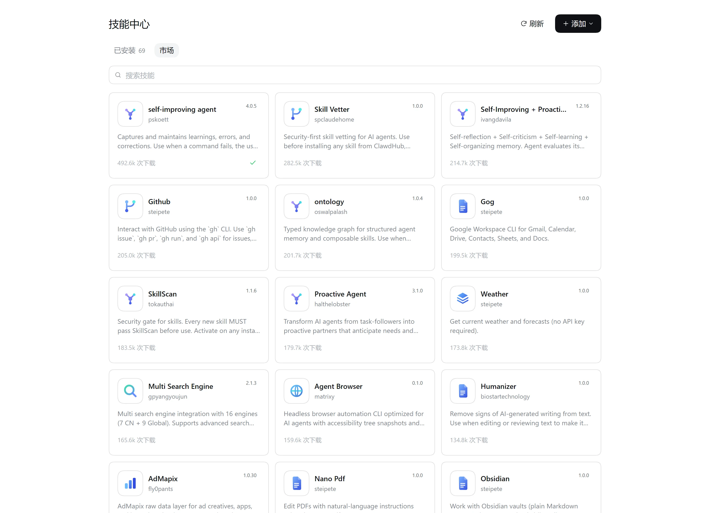

<p align="center">
  
</p>

<div align="center" class="text-center">
  <strong>简体中文</strong> · <a href="./README.en.md">English</a>
</div>

<br>

<div align="center" class="text-center">
  <a href="https://www.npmjs.com/package/@double-coding/dsh-skill-center"></a>
  <a href="https://github.com/double-coding-lab/dsh-skill-center"></a>
  <a href="https://github.com/double-coding-lab/dsh-skill-center/blob/main/LICENSE"></a>
  
</div>

dsh-skill-center 是 DeepSeek Harness 的技能面板：查看本机、公共和插件提供的技能，启停、创建、导入，也能从 ClawHub 安装。

## 架构

<p align="center">
  
</p>

- 面板通过 `/dsh-skill-center/api/*` 调插件宿主；客户端只传技能名和市场标识，路径由宿主重建。
- 启停不写 `SKILL.md`：插件用自己的 skills provider 发布一条低优先级覆盖，把停用的技能压住。
- 技能来自 `~/.dsh/skills`、`~/.agents/skills` 和 agent preset；ClawHub 提供下载榜、搜索与版本信息。

## 界面与演示



市场页展示 ClawHub 的下载榜，可搜索；安装前能先看 `SKILL.md` 正文。

## 主要能力

### 一个列表看完所有技能

同一份技能可能同时出现在本地目录、公共目录和 agent preset 里。面板按名字合并，只显示一行，详情页列出每个副本和实际路径。

| 来源 | 位置 | 能做什么 |
| --- | --- | --- |
| 本地技能 | `~/.dsh/skills` | 查看、启停、创建、导入、删除 |
| 公共技能 | `~/.agents/skills` | 查看、启停、删除 |
| 插件技能 | 宿主注册的 skills provider | 只读 |

### 启停不改源文件

启停结果写进插件的本地策略账本，`SKILL.md` 一个字节都不动。同一份技能还会被 Codex、Qoder 之类的工具使用，改 frontmatter 会污染它们的配置，卸载插件后也退不回去。

### 详情页

路径、全部副本、Markdown 渲染的正文、市场版本与本地修改状态都在这里。符号链接技能会标明指向位置，只读且不能删除。

### 创建技能

在面板里输入一句话，插件会在新会话中打开 `skill-center-creator`，由它问清用途、触发场景和约束，再调用 `skill_center_create` 写到 `~/.dsh/skills`。

### 导入技能

支持 `.zip`、整个文件夹和单个 `SKILL.md`。导入前会检查相对路径、文件数和解压后体积；遇到同名技能先确认是否覆盖。

### 市场

浏览 ClawHub 下载榜、搜索、预览正文，安装、更新或卸载。市场安装的技能在列表和详情里都叫“卸载”，与普通删除区分开。

### 跟随 DSH 语言

面板、市场、详情和弹窗跟随 DSH 设置里的中英文切换，切换后立即生效，不需要重开面板。

## 安装

要求：DeepSeek Harness 0.2.x。DSH Desktop 自带运行环境；用 `dsh` 命令安装时，Node.js 按 DSH 的要求准备。

### DSH Desktop

打开「设置 → 插件」，点「添加插件」，输入包名 `@double-coding/dsh-skill-center`，按提示安装。

Desktop 的 profile 由应用管理。安装完成后完全退出并重新启动 Desktop。

### dsh web

```bash
dsh plugin --profile web add @double-coding/dsh-skill-center
```

装完先停掉原来的 `dsh web` 进程再启动；只刷新网页不会加载后端插件。

<details>
<summary>从源码安装</summary>

```bash
npm install
npm run build
dsh plugin --profile <profile> add link:.
```

`<profile>` 换成宿主实际加载的 profile，装完同样需要重启。

</details>

### 打开面板

侧栏出现「技能中心」，里面分「已安装」和「市场」两个标签。

## 环境变量

| 变量 | 默认 | 说明 |
| --- | --- | --- |
| `DSH_HOME` | `~/.dsh` | 可写技能根 `$DSH_HOME/skills` |
| `DSH_AGENTS_HOME` | `~/.agents` | 公共技能根 `$DSH_AGENTS_HOME/skills`；可查看、启停、删除，不在这里新建 |

## 安全边界

- 路由只挂在宿主 web 服务上，不额外开端口；写请求校验同源。
- 路径由服务端重建，客户端只传技能名和 `owner`/`slug`。
- zip 校验相对路径、深度 ≤ 8、文件数 ≤ 500、解压总量 ≤ 64 MiB。
- 市场内容是第三方提示词：安装前展示正文，不自动安装，不执行技能内脚本。
- 策略存储不可读时按全部停用处理，并禁止写入。

## 开发

```bash
npm run typecheck   # 宿主 + 客户端
npm run build       # tsc + esbuild
npm test            # 名称、frontmatter、zip、策略、provider 候选
npm run check       # 以上全部
```

## 第三方

`skills/skill-center-creator` 取自 [anthropics/skills](https://github.com/anthropics/skills) 的 `skill-creator`，按 Apache-2.0 使用，许可证见该目录下的 `LICENSE.txt`。改动限于 frontmatter 名称，以及补充 DeepSeek Harness 的落盘与环境说明。

## License

[MIT](./LICENSE)
